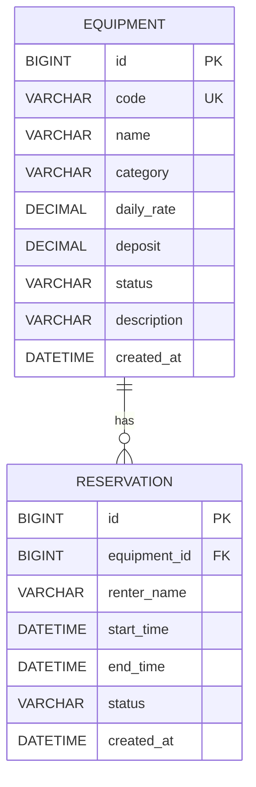

# 数据库设计：设备租赁与预约管理平台

## 数据库与实体关系

应用使用 MySQL 8.4，数据库名为 `equipment_rental`，存储引擎为 InnoDB，字符集为 `utf8mb4`。一条设备记录表示一台具有唯一编号的具体设备；一台设备可以有多条预约，一条预约只能关联一台设备。



## equipment：设备表

| 字段 | MySQL 类型 | 约束及含义 |
| --- | --- | --- |
| `id` | BIGINT | 主键、自增 |
| `code` | VARCHAR(64) | 非空、唯一；Service 去掉首尾空格并统一大写 |
| `name` | VARCHAR(100) | 非空，设备名称 |
| `category` | VARCHAR(50) | 非空，设备分类 |
| `daily_rate` | DECIMAL(12,2) | 非空，日租金不能为负 |
| `deposit` | DECIMAL(12,2) | 非空，押金不能为负 |
| `status` | VARCHAR(20) | 非空，仅允许 AVAILABLE、MAINTENANCE、OFF_SHELF |
| `description` | VARCHAR(1000) | 可空，设备说明 |
| `created_at` | DATETIME(6) | 非空，创建时间 |

`uk_equipment_code` 保证编号唯一，`ck_equipment_rate`、`ck_equipment_deposit` 保证金额非负。编号比较采用不区分大小写、区分重音的 `utf8mb4_0900_as_ci` 排序规则。

## reservation：预约表

| 字段 | MySQL 类型 | 约束及含义 |
| --- | --- | --- |
| `id` | BIGINT | 主键、自增 |
| `equipment_id` | BIGINT | 非空，外键指向 equipment.id |
| `renter_name` | VARCHAR(100) | 非空，预约人姓名 |
| `start_time` | DATETIME(6) | 非空，开始时间 |
| `end_time` | DATETIME(6) | 非空，结束时间必须晚于开始时间 |
| `status` | VARCHAR(20) | 非空，仅允许 CONFIRMED、CANCELLED、COMPLETED |
| `created_at` | DATETIME(6) | 非空，创建时间 |

`fk_reservation_equipment` 保证预约引用的设备存在，不进行级联删除。`ck_reservation_time` 保证 `end_time > start_time`。复合索引 `idx_reservation_equipment_time` 包含设备、状态、开始时间和结束时间，服务于预约冲突查询。

时间采用本地业务时间 `LocalDateTime`，按 Asia/Shanghai 使用；金额使用 BigDecimal，保留两位小数。

## JPA 与业务规则

两个模型通过 `@Entity`、`@Table`、`@Id` 和 `@GeneratedValue(IDENTITY)` 映射数据库表。`Reservation.equipment` 使用单向 `@ManyToOne(fetch = LAZY)` 及 `@JoinColumn` 映射外键，Equipment 不维护预约集合。枚举使用字符串保存。

`repository` 包中的 `EquipmentRepository` 和 `ReservationRepository` 继承 `JpaRepository`。Controller 继续使用请求和响应 DTO，由 Service 调用 Repository 完成读写。预约查询使用 `@EntityGraph` 加载所需设备信息，因此关闭 Open EntityManager in View 后仍可正确生成响应。

同一设备的 CONFIRMED 预约满足 `已有开始 < 新结束 AND 已有结束 > 新开始` 时冲突；首尾相接不冲突。该规则跨越多行记录，不能仅靠普通唯一约束表达，创建预约时由 Service 在事务中取得设备行的悲观写锁，再检查冲突并保存。设备行锁在事务提交或回滚后释放。

## 建表与数据准备

- `monolith/scripts/create-database.sql`：创建项目数据库，可以重复执行。
- `monolith/src/main/resources/schema-mysql.sql`：包含两张表、主键、唯一约束、外键、CHECK 约束和索引。应用启动时通过 Spring SQL 初始化执行，`CREATE TABLE IF NOT EXISTS` 保留已有数据。
- JPA 配置 `ddl-auto: validate`，启动时核对字段映射，不在重启时删除数据。已有数据库结构变化需要另行修改表结构。
- `monolith/scripts/demo-data.sql`：应用首次启动建表后手动执行，准备一台 DEMO-CAM-001 设备和一条有效预约。脚本按稳定编号和时间段查询后插入，顺序重复执行不会添加重复样例，也不会删除已有数据。
- `monolith/src/test/resources/application.yml`：自动化测试连接独立 H2 内存数据库，由 Hibernate 建表。Repository、Service 和 API 测试各自准备数据，并通过测试事务回滚清理，不依赖本地 MySQL 或残留数据。

## 本地验证

安装、连接配置和完整命令见根目录 README。在 `monolith/` 执行：

```bash
mysql -u root < scripts/create-database.sql
./mvnw spring-boot:run
```

保持应用运行，在另一个终端进入 `monolith/`：

```bash
mysql -u root equipment_rental < scripts/demo-data.sql
mysql -u root equipment_rental < scripts/demo-data.sql
mysql -u root equipment_rental -e "SELECT id, code, name, status FROM equipment; SELECT id, equipment_id, renter_name, status FROM reservation;"
curl -i http://localhost:8080/api/equipment
curl -i http://localhost:8080/api/reservations
```

有密码时为 mysql 命令加上 `-p` 并按提示输入。重复执行样例脚本后，每台样例设备和对应预约应仍各有一条；重启应用后 API 仍能读取这些记录。截图可展示 Repository 和实体映射、MySQL 表结构与查询结果，以及重启后的接口响应，保存到 `docs/homework/week-04/screenshots/`。

参考：[MySQL 建库说明](https://dev.mysql.com/doc/refman/8.4/en/create-database.html)、[Spring Data JPA 锁机制](https://docs.spring.io/spring-data/jpa/reference/jpa/locking.html)。
