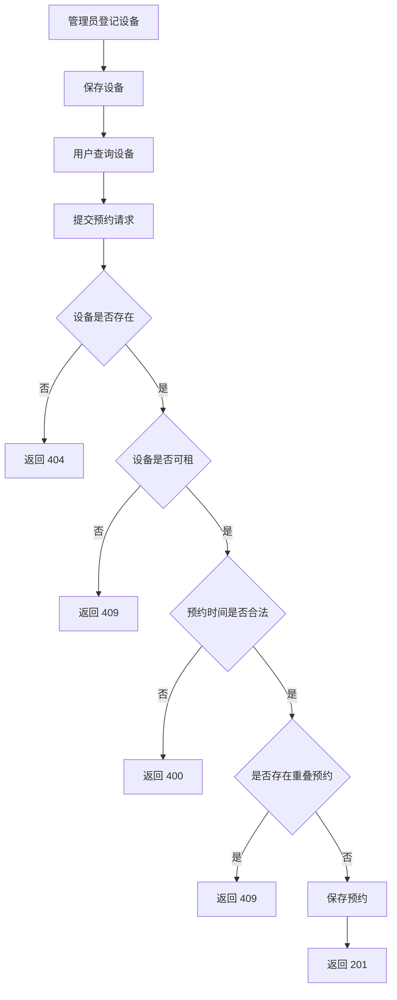
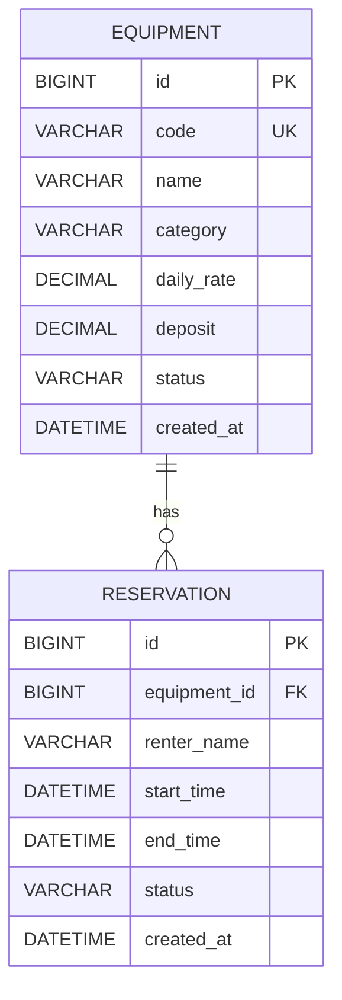

# 项目提案：设备租赁与预约管理平台

## 项目名称

**设备租赁与预约管理平台**

## 项目概述

本项目面向需要短期使用摄影器材、实验设备或运动器材的用户，提供设备查询、时间段预约、库存锁定、租赁订单、领取归还、费用结算、维修管理和消息通知等功能。平台以设备生命周期为主线，统一记录设备从可租、预约、领取、使用、归还、维修到再次可租的状态变化，减少人工登记造成的预约冲突和状态错误。

## 目标用户

| 用户角色 | 主要需求 |
| --- | --- |
| 租赁用户 | 查询设备及可用时间，提交或取消预约，查看订单、费用和到期提醒 |
| 设备管理员 | 维护设备与库存，处理预约，办理领取和归还，登记验收结果 |
| 维修人员 | 接收维修任务，记录检测结果与维修进度，确认设备能否重新出租 |
| 平台管理员 | 管理用户、角色、设备分类和业务规则，查看异常订单与运营数据 |

## 第 04 周实现目标

本周围绕“管理员登记设备，用户查询设备并创建预约”的核心业务流程进行实现。系统在创建预约前检查设备状态、预约时间和已有预约，防止同一台设备在重叠时间段内被重复预约。当前已完成业务模型、Service 规则、REST API 和基于 JPA、MySQL 的数据库持久化。

为控制本周范围，一条设备记录表示一台具有唯一编号的具体设备，而不是一类设备的总库存。例如，“佳能 EOS R5，编号 CAMERA-001”对应一条设备记录。预约人暂时使用姓名表示，本周不额外创建用户实体。

## 核心业务流程

### 设备登记与预约

1. 设备管理员创建设备，填写设备编号、名称、分类、租金、押金和说明，系统将初始状态设为 AVAILABLE。
2. 系统保存设备，并保证设备编号唯一。
3. 用户查询设备列表，选择状态为“可租”的设备。
4. 用户提交设备 ID、预约人、开始时间和结束时间。
5. Controller 使用请求 DTO 接收预约信息，并将业务处理交给 Service。
6. Service 检查设备是否存在、设备是否可租，以及预约起止时间是否合法。
7. Service 查询该设备已有的有效预约，检查是否存在时间重叠。
8. 校验通过后，系统创建状态为“已确认”的预约，通过 Repository 保存到 MySQL 数据库。
9. 系统返回创建成功的预约信息；若校验失败，则返回对应的错误结果。



## 核心实体

### 1. 设备（Equipment）

`Equipment` 表示平台中可以被查询和预约的一台具体设备。

| 字段 | Java 类型 | 说明 | 约束 |
| --- | --- | --- | --- |
| `id` | `Long` | 设备主键 | 自动生成、非空 |
| `code` | `String` | 设备编号 | 非空、唯一 |
| `name` | `String` | 设备名称 | 非空 |
| `category` | `String` | 设备分类 | 非空 |
| `dailyRate` | `BigDecimal` | 每日租金 | 非空、不能为负数 |
| `deposit` | `BigDecimal` | 押金 | 非空、不能为负数 |
| `status` | `EquipmentStatus` | 设备状态 | 非空 |
| `description` | `String` | 设备说明 | 可选 |
| `createdAt` | `LocalDateTime` | 创建时间 | 非空 |

设备状态包括：

- `AVAILABLE`：设备可租，可以创建预约。
- `MAINTENANCE`：设备维修中，不能创建预约。
- `OFF_SHELF`：设备已下架，不能创建预约。

### 2. 预约（Reservation）

`Reservation` 表示用户在指定时间段内对一台设备提出的预约。

| 字段 | Java 类型 | 说明 | 约束 |
| --- | --- | --- | --- |
| `id` | `Long` | 预约主键 | 自动生成、非空 |
| `equipment` | `Equipment` | 被预约的设备 | 非空、外键关联 |
| `renterName` | `String` | 预约人姓名 | 非空 |
| `startTime` | `LocalDateTime` | 预约开始时间 | 非空 |
| `endTime` | `LocalDateTime` | 预约结束时间 | 非空、晚于开始时间 |
| `status` | `ReservationStatus` | 预约状态 | 非空 |
| `createdAt` | `LocalDateTime` | 预约创建时间 | 非空 |

预约状态包括：

- `CONFIRMED`：预约已生效，参与时间冲突检查。
- `CANCELLED`：预约已取消，不占用设备时间。
- `COMPLETED`：预约对应的租赁已经完成。

## 实体关系

一台设备可以关联多条不同时间段的预约，一条预约只能属于一台设备，因此 `Equipment` 与 `Reservation` 是一对多关系：

```text
Equipment 1 -------- N Reservation
```

JPA 实现采用从 `Reservation` 到 `Equipment` 的单向多对一关联：

```java
@ManyToOne(fetch = FetchType.LAZY, optional = false)
@JoinColumn(name = "equipment_id", nullable = false)
private Equipment equipment;
```

本阶段不在 `Equipment` 中维护 `List<Reservation>`，以避免不必要的双向关联和 JSON 循环引用。



## Service 业务规则

### 核心规则：禁止重叠预约

同一台设备不能存在时间重叠的有效预约。创建新预约时，`ReservationService` 只检查状态为 `CONFIRMED` 的已有预约；已经取消的预约不占用设备时间。

已有预约与新预约发生时间重叠的条件为：

```text
已有预约开始时间 < 新预约结束时间
并且
已有预约结束时间 > 新预约开始时间
```

对应的判断逻辑为：

```java
existingStart.isBefore(requestedEnd)
        && existingEnd.isAfter(requestedStart)
```

例如，已有预约为 `10:00-12:00`，新预约为 `11:00-13:00`，两者发生重叠，新预约应被拒绝。若新预约为 `12:00-14:00`，两个时间段首尾相接但没有重叠，可以创建预约。

### 辅助规则

创建预约时，Service 还需要检查：

- 设备必须存在，否则返回资源不存在错误。
- 设备状态必须为 `AVAILABLE`，维修中或已下架的设备不能预约。
- 预约人姓名、开始时间和结束时间不能为空。
- 结束时间必须晚于开始时间。

接口使用以下 HTTP 结果表达校验结论：

| 情况 | HTTP 状态码 |
| --- | ---: |
| 预约创建成功 | `201 Created` |
| 请求字段或时间范围错误 | `400 Bad Request` |
| 设备不存在 | `404 Not Found` |
| 设备不可租或预约时间冲突 | `409 Conflict` |

## 本周范围与暂不实现内容

本周已实现设备登记、设备查询、创建预约、查询预约、预约冲突检查，以及 JPA 与 MySQL 数据库持久化。数据库设计见 `docs/database.md`。暂不实现用户注册登录、真实支付、领取归还、续租、维修流程、消息通知和微服务拆分，这些能力将在当前业务闭环稳定后继续扩展。
